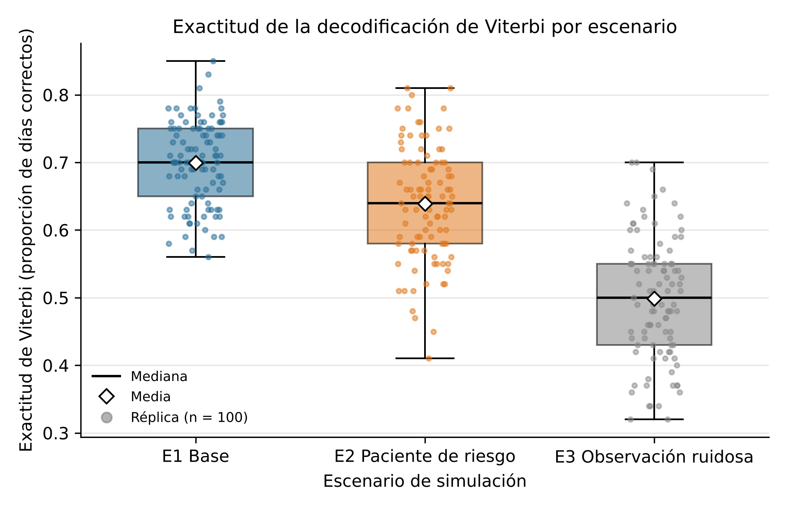
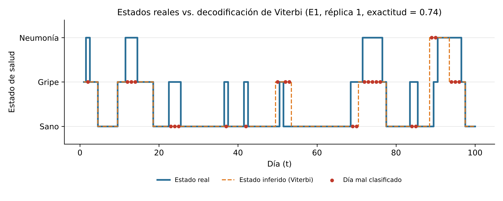
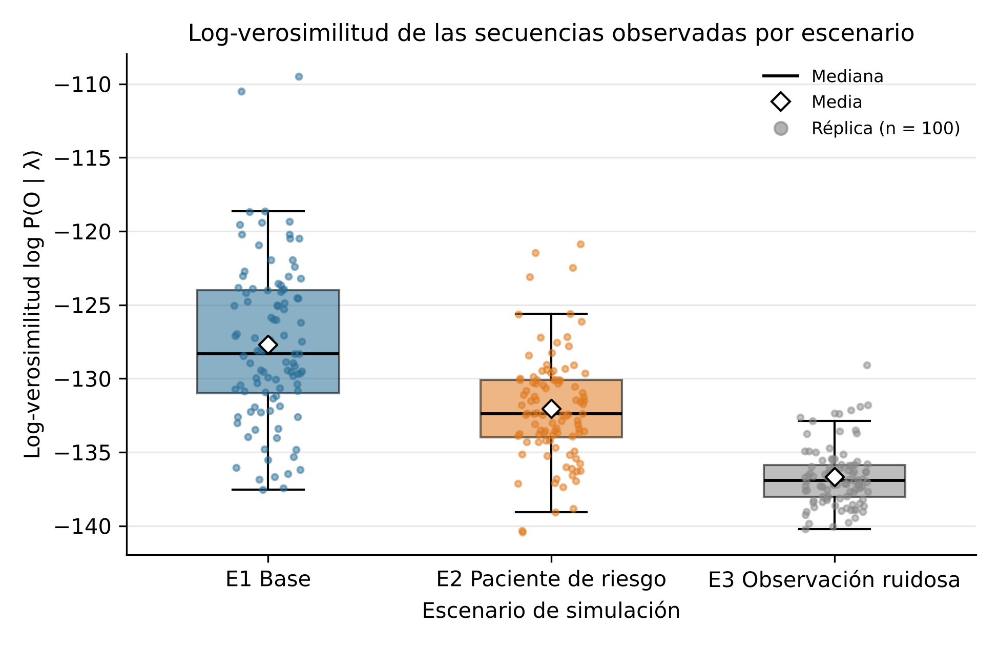
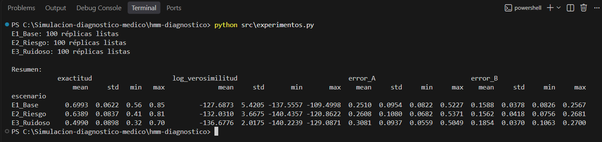

# HMM para diagnóstico médico — Simulación

Modelo Oculto de Markov (HMM) discreto que simula la evolución diaria del estado de salud de un paciente
(**Sano, Gripe, Neumonía**, estados ocultos) a partir de síntomas observados
(**Sin síntomas, Tos, Fiebre, Fatiga**).

Actividad didáctica 2-m2 — Simulación, IU Digital de Antioquia.
Integrantes: Gilliam Argel Monterroza, Leydi Correa Herrera, Sergio Andrés Agudelo Marulanda, Arley Steven Franco Galeano.

> Modelo académico: los parámetros son supuestos ilustrativos y no deben usarse para diagnóstico real.

## Estructura

```
├── src/
│   ├── hmm.py            # Clase HMM: validar, simular, Forward, Viterbi + Baum-Welch
│   ├── experimentos.py   # 3 escenarios x 100 réplicas -> CSV
│   └── analisis_resultados.py  # estadísticas, IC 95 %, pruebas y figuras
├── resultados/
│   ├── simulaciones.csv                # una fila por réplica
│   ├── secuencia_ejemplo.csv           # estados reales vs. Viterbi (E1, réplica 1)
│   ├── estadisticas_por_escenario.csv  # media, DE, mín., máx., IC 95 % (Tabla 1)
│   └── pruebas_estadisticas.csv        # Kruskal-Wallis y Welch por pares (Tabla 2)
├── figuras/
│   ├── fig1_exactitud_boxplot.png         # Figura 1 (300 dpi)
│   ├── fig2_reales_vs_viterbi.png         # Figura 2 (300 dpi)
│   └── fig3_logverosimilitud_boxplot.png  # Figura 3 (300 dpi)
├── notebooks/             # análisis de resultados
└── requirements.txt
```

## Instalación y ejecución

```bash
git clone https://github.com/sergioagudelo58-rgb/hmm-diagnostico-medico-grupo31.git
cd hmm-diagnostico-medico-grupo31
pip install -r requirements.txt
python src/experimentos.py          # 1) simulación -> resultados/*.csv
python src/analisis_resultados.py   # 2) estadísticas y figuras -> resultados/ y figuras/
```

En Google Colab: sube las carpetas `src/` y `resultados/`, y ejecuta `!python src/experimentos.py` y luego `!python src/analisis_resultados.py`.

## Parámetros del experimento

| Parámetro | Valor |
|---|---|
| Días por secuencia (T) | 100 |
| Réplicas por escenario | 100 |
| Semilla | 42 + número de réplica (42 a 141) |
| Iteraciones máx. Baum-Welch | 100 (tolerancia 1e-4) |

## Escenarios

| Escenario | Cambio respecto al base |
|---|---|
| E1 Base | π = [0.70, 0.25, 0.05]; A y B de la sección 3 del documento |
| E2 Paciente de riesgo | π = [0.30, 0.40, 0.30]; A = [[0.70, 0.22, 0.08], [0.20, 0.65, 0.15], [0.03, 0.17, 0.80]] |
| E3 Observación ruidosa | B = [[0.40, 0.25, 0.15, 0.20], [0.25, 0.30, 0.25, 0.20], [0.20, 0.28, 0.30, 0.22]] |

## Métricas (columnas de `simulaciones.csv`)

| Columna | Significado |
|---|---|
| `exactitud` | % de días en que Viterbi acierta el estado real |
| `log_verosimilitud` | Log-probabilidad de los síntomas bajo el modelo (Forward) |
| `error_A`, `error_B` | Error absoluto medio entre las matrices estimadas por Baum-Welch y las reales |

## Resultados principales

Exactitud de Viterbi por escenario (100 réplicas; IC 95 % con t de Student):

| Escenario | Media | DE | IC 95 % |
|---|---|---|---|
| E1 Base | 0.699 | 0.062 | [0.687, 0.712] |
| E2 Paciente de riesgo | 0.639 | 0.084 | [0.622, 0.656] |
| E3 Observación ruidosa | 0.499 | 0.090 | [0.481, 0.517] |

Las diferencias entre escenarios son significativas (Kruskal-Wallis, p < 0.001).
Tablas completas en `resultados/estadisticas_por_escenario.csv` y `resultados/pruebas_estadisticas.csv`.







## Reproducibilidad

Con las mismas semillas, ejecutar el script dos veces produce archivos CSV idénticos.
Entorno probado: Python 3.13, numpy 2.5, pandas 3.0, matplotlib 3.11, scipy 1.18.

Verificación independiente: el repositorio se clonó en un entorno limpio y se ejecutaron ambos scripts sin cambios.
Las 300 exactitudes y `secuencia_ejemplo.csv` coincidieron exactamente; las métricas continuas difirieron como
máximo en 5.7e-14 (precisión de punto flotante). Las tres figuras regeneradas fueron idénticas byte a byte.

